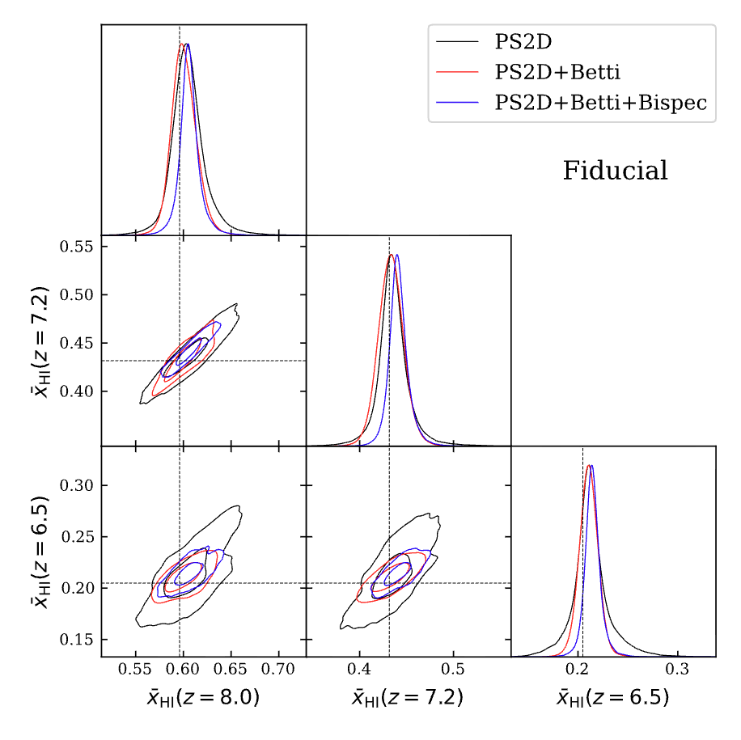

Happy to share that our paper [Cerardi, Giri, Bianco et al., 2026](https://academic.oup.com/mnras/article/549/1/stag779/8662579) has been published in MNRAS!
It compares and combines different summary statistics of the 21cm signal during Epoch of Reionization for inferring the ionization state of the Universe at these times.
In particular, we study Gaussian (1D and 2D power spectrum) and non-Gaussian statistics (Betti numbers and bispectrum). Our results show that Betti numbers capture critical topological information, which is complementary to the Gaussian information encoded in the powerspectrum. The figure below illustrates the gain in information from higher-order statistics 

